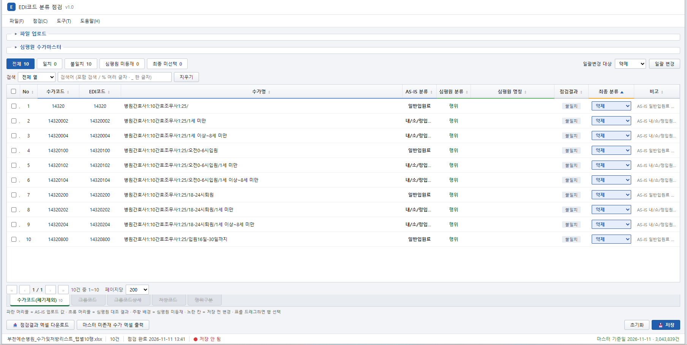

# EDI코드 분류 점검

병원이 보내온 **AS-IS 수가 엑셀**을 **심평원 수가마스터(약 300만 행)** 와 대조해, 행위 / 약제 / 치료재료 분류를 점검하고 최종 분류를 확정한 뒤 **원본 서식 그대로** 엑셀로 내보내는 업무 도구입니다.

> 병원 EMR(엣지 시스템) 도입 시 수작업으로 하던 "수가 코드 분류 검수"를 자동화하기 위해 만들었습니다.

| 업로드 전 | 업로드·점검 후 |
|---|---|
|  |  |

---

## 1. 해결하려는 문제

| 기존 방식 | 문제 |
|---|---|
| 병원마다 형식이 다른 수가 엑셀(탭·열 이름이 제각각)을 사람이 눈으로 확인 | 시간이 오래 걸리고 누락·오분류 발생 |
| 심평원 마스터를 엑셀로 받아 매번 직접 업로드 | 월 1회 갱신될 때마다 파일 관리 필요, 300만 행은 엑셀로 열기도 어려움 |
| 점검 결과를 새 엑셀로 다시 정리 | 병원 원본의 서식(글꼴·색·열 너비·병합 셀)이 사라짐 |

## 2. 주요 기능

- **탭별 열 지정** : 엑셀의 탭마다 `EDI코드 / 수가코드 / 수가명 / AS-IS 분류` 열 이름을 지정(자동 추정 지원), 쓰지 않을 탭은 제외
- **심평원 마스터 대조** : 업로드한 EDI코드를 마스터와 비교해 심평원 분류·명칭을 표시하고 **일치 / 불일치 / 심평원 미등재**로 판정
- **DB 직접 조회** : 화면에서 DB ID/PW만 입력하면 MySQL에서 최신 마스터(행위·약제·치료재료 3개 테이블)를 바로 가져옴
- **최종 분류 확정** : 행별 선택, 마우스 **드래그 다중 선택**, 대상(행위/약제/치료재료/전체)별 **일괄 변경**, 분류별 색상 구분
- **대용량 대응** : 수만 건 행에서도 정렬 · LIKE 검색(`%`, `_`) · 페이지 처리 · 상태 필터가 끊김 없이 동작
- **원본 서식 유지 내보내기** : 원본 `.xlsx`의 각 탭 맨 끝 열에 `최종 분류`만 추가 (미사용 탭도 그대로 보존)
- **마스터 미존재 수가 추출** : 심평원에 없는 수가만 따로 엑셀로 출력
- **설치 없는 배포** : 실행 파일 하나(`EDI_Classifier.exe`)를 더블클릭하면 끝, 브라우저 탭을 닫으면 자동 종료

## 3. 사용 흐름

```
[DB 직접 조회]  ─▶  심평원 마스터(약 300만 건) 확보
[파일 업로드]   ─▶  탭별 열 지정  ─▶  [심평원 점검]
                                         │
                    일치 / 불일치 / 미등재 판정 + 심평원 분류 표시
                                         │
              최종 분류 선택·일괄 변경 ─▶ [점검결과 엑셀 다운로드] (원본 서식 유지)
                                       └▶ [마스터 미존재 수가 엑셀 출력]
```

## 4. 기술적 도전과 해결

### ① 300만 행 마스터를 브라우저에서 어떻게 다룰까
브라우저는 MySQL에 직접 접속할 수 없고, 300만 행을 통째로 메모리에 올리면 느려집니다.
- 작은 Node 서버가 MySQL에서 읽은 결과를 **gzip TSV로 스트리밍**
- 브라우저는 `DecompressionStream`으로 **압축을 풀면서 즉시 필터링**, 업로드한 EDI코드와 일치하는 행만 보관 → 메모리 사용 최소화
- 한 번 받은 마스터는 파일(`.tsv.gz`)로 저장해 **VPN 없는 외부에서도** 점검 가능 (월 1회 갱신 주기에 맞춤)

### ② 원본 엑셀 서식을 유지한 채 열 추가
SheetJS로 다시 쓰면 서식이 손실됩니다. 그래서 `.xlsx`가 zip이라는 점을 이용해 **시트 XML을 직접 수정**했습니다.
- JSZip으로 압축을 풀고 `DOMParser`로 각 행에 `최종 분류` 셀 추가 (마지막 셀의 스타일 복사)
- `<dimension>`, `<cols>` 갱신, 깨지기 쉬운 `spans` 제거, XML 선언 중복 방지 (Excel 오류를 겪은 뒤 수정)
- `.xls`/`.csv`는 값만 복사하는 안전한 대체 경로 제공

### ③ 수만 건에서도 빠른 화면
페이지 단위 렌더링, 이벤트 위임, 행 인덱스 캐싱, 정렬·LIKE 검색을 적용하고 **5만 행 데이터로 동작을 검증**했습니다.

### ④ 개발자가 아닌 직원도 쓰게 만들기
- DB 접속 주소는 서버에 **고정**하고 사용자는 ID/PW만 입력 (비밀번호는 저장·로그 기록 안 함)
- **Node SEA(단일 실행 애플리케이션)** 로 서버·화면·라이브러리·`mysql2`를 exe 하나에 포함
- 콘솔 창 숨김, 중복 실행 방지, 포트 충돌 시 자동 우회, 브라우저 탭 종료 감지 후 자동 종료
- 오류는 exe 옆 `edi_log.txt`에 기록

## 5. 기술 스택

| 영역 | 사용 기술 |
|---|---|
| 화면 | HTML / CSS / Vanilla JavaScript (단일 파일, 프레임워크 없음) |
| 엑셀 처리 | SheetJS (xlsx), JSZip, DOMParser / XMLSerializer |
| 서버 | Node.js (`http`), mysql2 (스트리밍 조회) |
| 데이터 | MySQL (행위·약제·치료재료 3개 테이블, 약 300만 행), gzip TSV |
| 배포 | esbuild 번들 + Node SEA 단일 exe (약 98MB) |

## 6. 폴더 구조

```
├─ EDI코드_분류점검_예시.html   화면 및 점검 로직 (단일 파일)
├─ server.js                   화면 서빙 + DB 조회 API
├─ export_master.js            마스터 조회·gzip 스트리밍 모듈
├─ build_exe.js                단일 실행 파일 빌드 스크립트
├─ lib/                        xlsx, jszip (오프라인 동작)
├─ docs/                       README용 스크린샷
└─ README.txt                  사용자용 상세 사용 설명서
```

## 7. 실행 방법

- **사용자** : `EDI_Classifier.exe` 더블클릭 → 사내망/VPN에서 DB ID/PW 입력 후 사용 (자세한 순서는 [README.txt](README.txt))
- **개발자** :
  ```bash
  npm install
  node server.js            # http://localhost:3000
  node build_exe.js         # dist/EDI_Classifier.exe 생성
  ```

## 8. 한계와 개선 계획

- 제목 행 위에 안내 문구가 있는 시트는 그 줄을 열 이름 행으로 오인할 수 있음 → 열 이름 행 번호 / 열 문자(A, B…) 지정 기능 예정
- `.xls` / `.csv`는 서식 유지가 되지 않음 (`.xlsx`만 지원)
- exe는 서명되지 않아 처음 실행 시 Windows 경고가 나타날 수 있음 → 코드 서명 검토

---

> 병원 원본 데이터와 심평원 마스터 파일은 저장소에 포함하지 않습니다.
